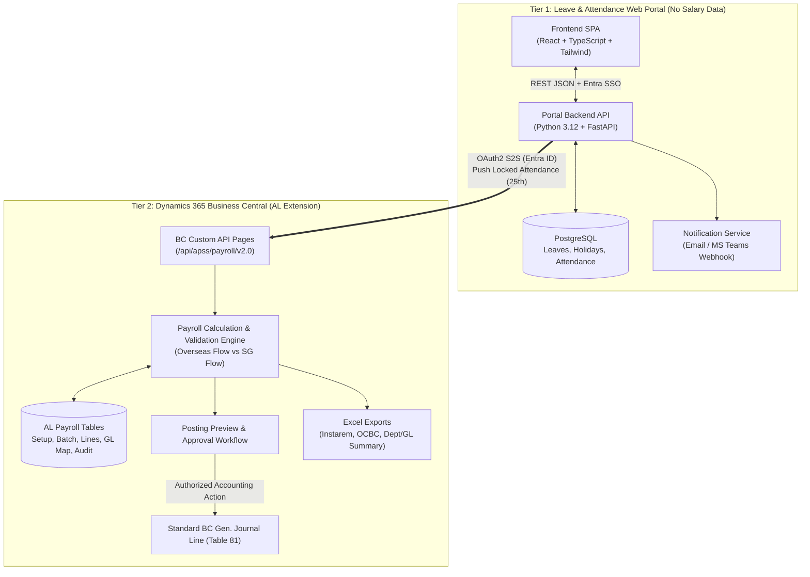
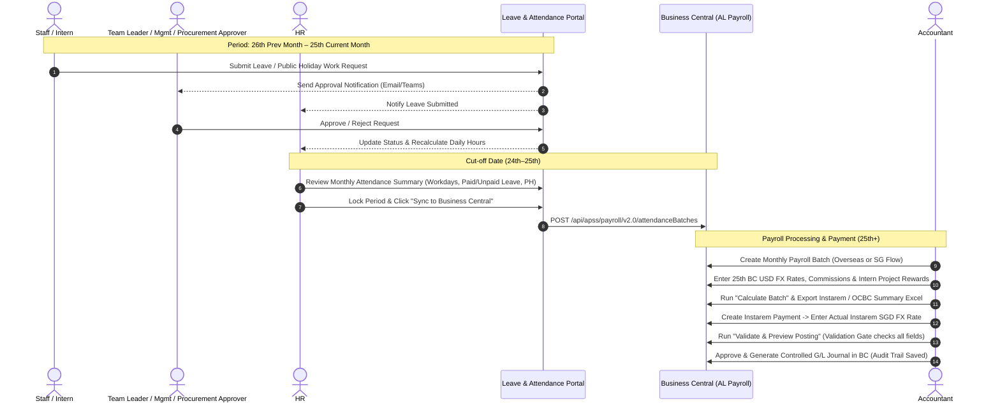

# APSS Salary Calculation — System Architecture & Workflow Design

**Epic:** `KAN-101` (`APSST-16`)  
**Target BC Platform:** Dynamics 365 Business Central Cloud v28.0 (`runtime: 17.0`, `NoImplicitWith`)

---

## 1. Architectural Strategy: Why Hybrid (Web Portal + BC AL Core)?

Combining the JIRA security controls (`KAN-101`) with the Leave Management requirement creates two distinct user groups:
1. **All Staff, Overseas Contractors, Interns & Team Leaders:** Need a fast, intuitive interface to submit/approve leave requests and check country public holidays **without requiring Business Central licenses for every contractor/intern** and **without ever touching salary data**.
2. **Accounting, Finance & Management (`Accountant`, `Payroll Viewer`):** Need salary calculation, FX conversion, validation gates, posting previews, audit trails, and G/L journal creation **strictly inside Business Central** (the system of record).

### Two-Tier Boundary Principle
- **Tier 1 — Leave & Attendance Portal (React + FastAPI + PostgreSQL):** Handles *only* leave applications, multi-approver notifications, country public holiday calendars, and HR's monthly attendance lock (`26th–25th`). **Stores zero salary/commission numbers.**
- **Tier 2 — Payroll & G/L Engine (Business Central AL Extension):** Receives locked monthly attendance via BC Custom API v2.0, holds all sensitive salary/commission/FX data under BC `PermissionSet` controls, enforces validation gates, exports Excel payment summaries (`Instarem` / `OCBC`), and generates controlled `Gen. Journal Line` entries.



> [!NOTE]
> **Alternative (100% BC AL Only):** If *all* overseas contractors and interns already hold Business Central Team Member licenses, Tier 1 can also be built as AL Pages inside BC. However, the Hybrid model aligns with APSS's existing pattern (`Sourcing-Engine`: Python FastAPI + PostgreSQL + BC AL) and avoids BC licensing costs for contractors/interns.

---

## 2. Technology Stack

| Layer | Technology | Rationale |
|---|---|---|
| **ERP / Core Payroll** | **AL (BC Cloud v28, Runtime 17.0)** | Native access to BC G/L Accounts, Dimensions, Currencies, Gen. Journals, Excel Buffer, and BC PermissionSets. Proposed ID range: `50200..50299`. |
| **Portal Backend** | **Python 3.12 + FastAPI + SQLAlchemy 2.0 + Alembic** | Consistent with existing APSS backend services (`Sourcing-Engine`); clean async notifications and OAuth2 BC client. |
| **Portal Database** | **PostgreSQL 16** | Reliable relational storage for leave state machines, holiday calendars, and attendance snapshots. |
| **Portal Frontend** | **React 19 + TypeScript + Vite (or Next.js) + Tailwind CSS + shadcn/ui** | Clean, responsive UI for leave submission, calendar view, 1-click approvals, and HR attendance review table. |
| **Authentication** | **Microsoft Entra ID (Azure AD) OAuth2 / OIDC** | Corporate SSO for staff/HR/approvers; Client Credentials flow (S2S) between FastAPI and BC API v2.0. |
| **Notifications** | **Microsoft Graph Mail API / Teams Incoming Webhook** | Instant notifications to Team Leader, Management Approver, Procurement Approver, and HR. |

---

## 3. End-to-End Monthly Workflow



---

## 4. Component Design

### 4.1. Tier 1 — Web Portal (Frontend & FastAPI Backend)

#### Frontend Screens
1. **Employee Dashboard (`/dashboard`):** Upcoming local country Public Holidays, current period (`26th–25th`) attendance hours preview, quick "Request Leave / PH Work" button, personal request history.
2. **Leave Request Modal (`/leaves/new`):** Select type (`Annual Leave - Paid`, `Unpaid Leave - Full Day`, `Unpaid Leave - Half Day`, `Public Holiday Worked - 2x`), date range, reason/attachment.
3. **Approver Inbox (`/approvals`):** Pending requests for assigned team (+ Procurement routing rule), 1-click Approve/Reject with comment.
4. **HR Attendance Console (`/hr/attendance`):** Filter by period (`2026-11`: `26 Oct – 25 Nov`), department, country; displays `Standard Working Days`, `Normal Hours`, `Paid Leave`, `Unpaid Leave`, `PH Off (8h)`, `PH Worked (16h)`, `Total Payable Hours`; **"Lock & Sync to BC"** action.
5. **Admin Holiday & Routing Config (`/admin/settings`):** Manage country Public Holiday calendars (`VN`, `SG`, `ID`, `TH`, `MY`, `MM`) and department approver chains.

#### Portal PostgreSQL Schema (Core Tables)
- `users`: `id`, `bc_employee_no`, `email`, `full_name`, `department_code`, `country_code`, `employee_type` (`SG_STAFF`, `OVERSEAS_CONTRACTOR`, `INTERN`), `role`, `is_active`
- `approval_routes`: `id`, `department_code`, `approver_user_id`, `is_mandatory` *(handles Team Leader + Management + Procurement Approver)*
- `public_holidays`: `id`, `country_code`, `holiday_date`, `name`, `year`
- `leave_requests`: `id`, `user_id`, `leave_type`, `start_date`, `end_date`, `half_day_period`, `status` (`PENDING`, `APPROVED`, `REJECTED`, `CANCELLED`), `reason`, `created_at`
- `leave_approvals`: `id`, `leave_request_id`, `approver_id`, `decision`, `comment`, `decided_at`
- `attendance_periods`: `id`, `period_code` (`YYYY-MM`), `start_date` (`26th`), `end_date` (`25th`), `standard_working_days`, `status` (`OPEN`, `HR_LOCKED`, `SYNCED_TO_BC`), `synced_at`
- `attendance_summaries`: `id`, `period_id`, `user_id`, `normal_days`, `paid_leave_days`, `unpaid_leave_days`, `ph_not_worked_days`, `ph_worked_days`, `total_payable_hours`

#### Portal REST API Endpoints (`FastAPI`)
- `GET /api/v1/auth/me` — Current user profile & roles
- `GET /api/v1/holidays?country=VN&year=2026` / `POST /api/v1/holidays` — Country public holidays
- `POST /api/v1/leaves` / `GET /api/v1/leaves` — Submit & list leave requests (scoped by role)
- `POST /api/v1/leaves/{id}/decision` — Approve / reject request & trigger notifications
- `GET /api/v1/attendance/periods/{period_code}/summary` — Generate/view HR monthly attendance summary
- `POST /api/v1/attendance/periods/{period_code}/lock-and-sync` — Lock attendance & push payload to BC API

---

### 4.2. Tier 2 — Business Central AL Extension (`al-app/`)

#### Proposed AL Object Architecture (`idRanges: 50200..50299`)

| Object Type | Name | Responsibility |
|---|---|---|
| **Table** | `APSS Payroll Setup` | Cut-off day config (`26`..`25`), default Gen. Journal Template/Batch, API settings. |
| **Table** | `APSS Payroll Employee` | Links Employee/Vendor, `Flow Type` (`Singapore` vs `Overseas`), `Department Code`, `Country Code`, `Currency Code`, `Basic Salary`, `Payment Channel` (`Instarem`, `OCBC`), bank details. |
| **Table** | `APSS Dept. G/L Mapping` | Maps `Department / Category` (`Procurement`, `SCC`, `PASTOR CHE KO`, etc.) + `Component Type` to verified BC `G/L Account No.` (`7200`, `8040`, `9440`) and Dimensions (`KAN-107`). |
| **Table** | `APSS Payroll Batch Header` | Monthly header (`Period Code`, `Flow Type`, `Start Date`, `End Date`, `Standard Working Days`, `Status`: `Draft` → `Calculated` → `Validated` → `Approved` → `Journal Created` → `Posted`). |
| **Table** | `APSS Payroll Batch Line` | Per-employee calculation line: `Basic Salary`, `Payable Hours`, `Hourly Rate`, `Calculated Base`, `Commission`, `Project Reward`, `Net Orig. Currency`, `BC 25th USD Rate`, `Expense USD`, `Instarem SGD Rate`, `Payable SGD`, `Payment Channel`. |
| **Table** | `APSS Payroll FX Rate` | Stores monthly cut-off (25th) BC USD rates and post-payment Instarem SGD rates per currency. |
| **Table** | `APSS Payroll Audit Log` | Immutable audit trail of syncs, manual edits, FX updates, approvals, and journal creation (`KAN-106`). |
| **Codeunit** | `APSS Payroll Calc. Engine` | Executes SG monthly formula vs. Overseas hourly formula (`Basic / (StdDays * 8) * PayableHours`). |
| **Codeunit** | `APSS Payroll Validator` | Blocks batch if attendance is unlocked, FX rate = 0, department missing, or G/L account unverified (`KAN-105`). |
| **Codeunit** | `APSS Payroll Journal Post` | Builds Posting Preview buffer and creates controlled `Gen. Journal Line` entries (`KAN-109`). |
| **Codeunit** | `APSS Payroll Excel Export` | Exports `Instarem Summary`, `OCBC Summary`, and `Dept / G/L Expense Summary` via BC `Excel Buffer`. |
| **Page** | `APSS Payroll Batch List / Card` | Main UI for Accountant & `Payroll Viewer` inside Business Central. |
| **Page** | `APSS Payroll Posting Preview` | Read-only preview of aggregated G/L & Department journal entries before approval. |
| **API Page** | `APSS Attendance Sync API` | OData/REST v2.0 endpoint (`POST /api/apss/payroll/v2.0/companies({id})/attendanceSyncs`) receiving locked HR attendance from Tier 1. |
| **PermissionSet** | `APSS PAYROLL ADMIN` / `ACCT` / `VIEWER` | Enforces strict BC table/page access (`Accountant`, `Admin`, and read-only `Payroll Viewer`). |

---

## 5. Proposed Repository Structure

```text
APSS-Salary-Calculation/
├── al-app/                         # Tier 2: Business Central AL Extension (KAN-103..109)
│   ├── app.json                    # BC Platform 28.0, Runtime 17.0
│   └── src/
│       ├── Enum/
│       ├── Table/
│       ├── Page/
│       ├── API/
│       ├── Codeunit/
│       └── PermissionSet/
├── portal-backend/                 # Tier 1: Leave & Attendance FastAPI Service (KAN-104)
│   ├── pyproject.toml
│   ├── alembic/
│   ├── src/payroll_portal/
│   │   ├── api/
│   │   ├── models/
│   │   ├── services/               # Leave routing, Holiday calc, BC API sync client
│   │   └── notifications/
│   └── tests/
├── portal-frontend/                # Tier 1: React + TypeScript Web UI (KAN-104)
│   ├── package.json
│   └── src/
│       ├── pages/                  # Dashboard, LeaveForm, Approvals, HRAttendance, Admin
│       └── components/
└── docs/                           # Bilingual Requirements, JIRA Tracker & Architecture
```
