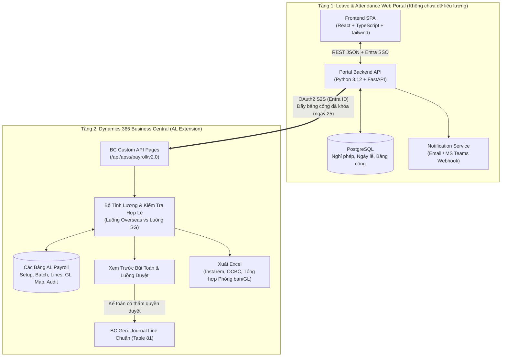
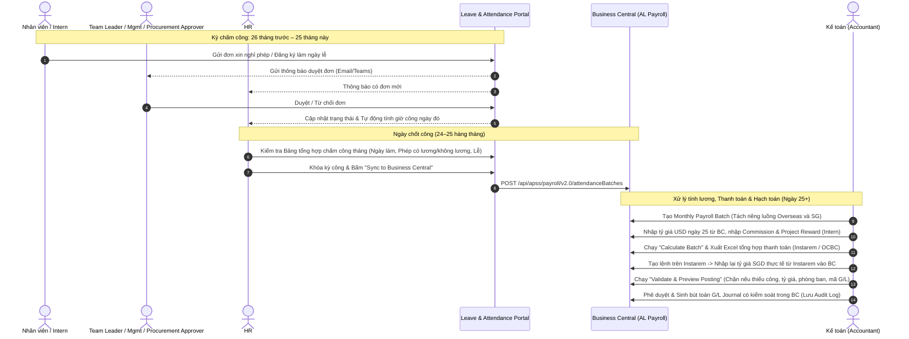

# APSS Salary Calculation — Thiết Kế Kiến Trúc Hệ Thống & Luồng Nghiệp Vụ

**Epic:** `KAN-101` (`APSST-16`)  
**Nền tảng BC mục tiêu:** Dynamics 365 Business Central Cloud v28.0 (`runtime: 17.0`, `NoImplicitWith`)

---

## 1. Chiến Lược Kiến Trúc: Vì Sao Chọn Mô Hình Hybrid (Web Portal + BC AL Core)?

Khi kết hợp yêu cầu kiểm soát bảo mật trên JIRA (`KAN-101`) với yêu cầu Quản lý nghỉ phép (Leave Management) của Kế toán, hệ thống phục vụ 2 nhóm người dùng rất khác nhau:
1. **Toàn bộ Nhân viên, Contracting Staff ở các nước, Intern & Team Leader:** Cần giao diện đơn giản để gửi/duyệt đơn nghỉ phép và xem lịch ngày lễ theo quốc gia **mà không tốn chi phí license Business Central cho từng contractor/intern**, đồng thời **tuyệt đối không chạm vào dữ liệu lương**.
2. **Kế toán, Tài chính & Quản lý (`Accountant`, `Payroll Viewer`):** Cần tính lương, quy đổi tỷ giá, kiểm tra điều kiện chặn (validation gate), xem trước bút toán (posting preview), lưu vết kiểm toán (audit trail) và tạo bút toán G/L **ngay bên trong Business Central** (hệ thống kế toán gốc).

### Nguyên Tắc Phân Tách 2 Tầng (Two-Tier Boundary)
- **Tầng 1 — Leave & Attendance Web Portal (React + FastAPI + PostgreSQL):** *Chỉ* xử lý đơn xin nghỉ phép, luồng thông báo/duyệt nhiều cấp, lịch ngày lễ theo quốc gia và bước HR khóa bảng công tháng (`26 tháng trước – 25 tháng này`). **Không lưu bất kỳ con số lương hay hoa hồng nào.**
- **Tầng 2 — Payroll & G/L Engine (Business Central AL Extension):** Nhận dữ liệu ngày công đã khóa từ Tầng 1 qua BC Custom API v2.0, lưu trữ bảo mật toàn bộ lương cơ bản/hoa hồng/tỷ giá bằng `PermissionSet` của BC, chạy công thức tính lương, xuất Excel thanh toán (`Instarem` / `OCBC`) và sinh bút toán `Gen. Journal Line` có kiểm soát.



> [!NOTE]
> **Phương án thay thế (100% BC AL):** Nếu *tất cả* nhân viên contracting và intern đều đã được cấp tài khoản Business Central (Team Member license), Tầng 1 có thể viết luôn bằng AL Page trong BC. Tuy nhiên, mô hình **Hybrid** đồng bộ hoàn toàn với kiến trúc hiện có của APSS (như dự án `Sourcing-Engine`: Python FastAPI + PostgreSQL + BC AL) và tiết kiệm chi phí license BC.

---

## 2. Ngôn Ngữ & Framework Đề Xuất

| Thành phần | Công nghệ | Lý do lựa chọn |
|---|---|---|
| **ERP / Lõi Tính Lương & Kế Toán** | **AL (BC Cloud v28, Runtime 17.0)** | Tích hợp trực tiếp với G/L Account, Dimension, Currency, Gen. Journal, Excel Buffer và PermissionSet của BC. Dải ID đề xuất: `50200..50299` (không trùng các app APSS hiện tại). |
| **Portal Backend** | **Python 3.12 + FastAPI + SQLAlchemy 2.0 + Alembic** | Đồng nhất với tech stack Python/FastAPI hiện tại của APSS; xử lý gửi thông báo bất đồng bộ và gọi BC OAuth2 API rất gọn. |
| **Portal Database** | **PostgreSQL 16** | Quản lý chặt chẽ trạng thái duyệt đơn, lịch nghỉ lễ đa quốc gia và bản chốt công hàng tháng. |
| **Portal Frontend** | **React 19 + TypeScript + Vite (hoặc Next.js) + Tailwind CSS + shadcn/ui** | Giao diện hiện đại, dễ dùng trên cả máy tính và điện thoại cho nhân viên xin nghỉ, sếp duyệt đơn 1-click và HR rà soát công. |
| **Xác thực (Auth)** | **Microsoft Entra ID (Azure AD) OAuth2 / OIDC** | Đăng nhập SSO bằng tài khoản công ty; kết nối Server-to-Server (Client Credentials) an toàn giữa FastAPI và BC API v2.0. |
| **Thông báo (Notification)** | **Microsoft Graph Mail API / Teams Webhook** | Bắn thông báo tức thì cho Team Leader, Management Approver, Procurement Approver và HR. |

---

## 3. Luồng Nghiệp Vụ Đầu – Cuối Hàng Tháng (Workflow)



---

## 4. Thiết Kế Chi Tiết Từng Phân Hệ

### 4.1. Tầng 1 — Web Portal (Frontend & FastAPI Backend)

#### Các Màn Hình Frontend
1. **Employee Dashboard (`/dashboard`):** Xem lịch ngày lễ sắp tới theo quốc gia của mình, tổng giờ công tạm tính kỳ hiện tại (`26–25`), nút tạo nhanh đơn nghỉ phép, lịch sử đơn cá nhân.
2. **Form Xin Nghỉ / Làm Ngày Lễ (`/leaves/new`):** Chọn loại (`Annual Leave - Paid 8h`, `Unpaid Full Day - 0h`, `Unpaid Half Day - 4h`, `Public Holiday Worked - 16h`), chọn ngày, lý do.
3. **Hộp Thư Duyệt Đơn (`/approvals`):** Dành cho Team Leader, Management Approver và Procurement Approver duyệt/từ chối 1-click kèm ghi chú.
4. **Bảng Tổng Hợp Công Cho HR (`/hr/attendance`):** Lọc theo kỳ (`2026-11`: `26/10 – 25/11`), phòng ban, quốc gia; hiển thị `Ngày công chuẩn`, `Ngày đi làm`, `Phép năm`, `Nghỉ không lương`, `Nghỉ lễ (8h)`, `Làm ngày lễ (16h)`, `Tổng giờ tính lương`; nút **"Khóa công & Đồng bộ sang BC"**.
5. **Quản Trị Lịch Lễ & Luồng Duyệt (`/admin/settings`):** Cấu hình lịch Public Holiday theo từng nước (`VN`, `SG`, `ID`, `TH`, `MY`, `MM`) và cấu hình người duyệt theo phòng ban.

#### Database Schema Trên PostgreSQL (Các Bảng Chính)
- `users`: `id`, `bc_employee_no`, `email`, `full_name`, `department_code`, `country_code`, `employee_type` (`SG_STAFF`, `OVERSEAS_CONTRACTOR`, `INTERN`), `role`, `is_active`
- `approval_routes`: `id`, `department_code`, `approver_user_id`, `is_mandatory` *(cấu hình linh hoạt cho Team Leader + Management + thêm Procurement Approver cho team Procurement)*
- `public_holidays`: `id`, `country_code`, `holiday_date`, `name`, `year`
- `leave_requests`: `id`, `user_id`, `leave_type`, `start_date`, `end_date`, `half_day_period`, `status` (`PENDING`, `APPROVED`, `REJECTED`, `CANCELLED`), `reason`, `created_at`
- `leave_approvals`: `id`, `leave_request_id`, `approver_id`, `decision`, `comment`, `decided_at`
- `attendance_periods`: `id`, `period_code` (`YYYY-MM`), `start_date` (`26`), `end_date` (`25`), `standard_working_days`, `status` (`OPEN`, `HR_LOCKED`, `SYNCED_TO_BC`), `synced_at`
- `attendance_summaries`: `id`, `period_id`, `user_id`, `normal_days`, `paid_leave_days`, `unpaid_leave_days`, `ph_not_worked_days`, `ph_worked_days`, `total_payable_hours`

#### REST API Endpoints (`FastAPI`)
- `GET /api/v1/auth/me` — Lấy thông tin user và quyền hiện tại
- `GET /api/v1/holidays?country=VN&year=2026` / `POST /api/v1/holidays` — Quản lý lịch ngày lễ quốc gia
- `POST /api/v1/leaves` / `GET /api/v1/leaves` — Tạo & xem danh sách đơn nghỉ phép (phân quyền theo role)
- `POST /api/v1/leaves/{id}/decision` — Duyệt / từ chối đơn & bắn email/Teams notification
- `GET /api/v1/attendance/periods/{period_code}/summary` — Xuất bảng tổng hợp công tháng cho HR kiểm tra
- `POST /api/v1/attendance/periods/{period_code}/lock-and-sync` — Khóa kỳ công & đẩy dữ liệu sang BC API

---

### 4.2. Tầng 2 — Business Central AL Extension (`al-app/`)

#### Các Object AL Dự Kiến (`idRanges: 50200..50299`)

| Loại Object | Tên Object | Chức năng |
|---|---|---|
| **Table** | `APSS Payroll Setup` | Cấu hình ngày cut-off (`26`..`25`), Gen. Journal Template/Batch mặc định. |
| **Table** | `APSS Payroll Employee` | Hồ sơ lương nhân sự trong BC: `Flow Type` (`Singapore` vs `Overseas`), `Department Code`, `Country Code`, `Currency Code`, `Basic Salary`, `Payment Channel` (`Instarem`, `OCBC`), tài khoản nhận. |
| **Table** | `APSS Dept. G/L Mapping` | Ánh xạ `Phòng ban / Hạng mục` (`Procurement`, `SCC`, `PASTOR CHE KO`...) sang `G/L Account No.` (`7200`, `8040`, `9440`) và Dimension (`KAN-107`). |
| **Table** | `APSS Payroll Batch Header` | Quản lý kỳ lương theo tháng (`Period Code`, `Flow Type`, `Start Date`, `End Date`, `Standard Working Days`, `Status`: `Draft` → `Calculated` → `Validated` → `Approved` → `Journal Created` → `Posted`). |
| **Table** | `APSS Payroll Batch Line` | Dòng tính lương từng người: `Basic Salary`, `Payable Hours`, `Hourly Rate`, `Calculated Base`, `Commission`, `Project Reward`, `Net Orig. Currency`, `BC 25th USD Rate`, `Expense USD`, `Instarem SGD Rate`, `Payable SGD`, `Payment Channel`. |
| **Table** | `APSS Payroll FX Rate` | Lưu tỷ giá USD ngày 25 từ BC và tỷ giá SGD thực tế từ Instarem theo từng tháng. |
| **Table** | `APSS Payroll Audit Log` | Lưu vết bất biến mọi thao tác đồng bộ, sửa tay, nhập tỷ giá, duyệt và tạo bút toán (`KAN-106`). |
| **Codeunit** | `APSS Payroll Calc. Engine` | Thực thi công thức riêng cho luồng SG (lương tháng) và luồng Overseas (`Basic / (StdDays * 8) * PayableHours`). |
| **Codeunit** | `APSS Payroll Validator` | Chốt chặn kiểm tra: báo lỗi và chặn duyệt nếu thiếu khóa công, tỷ giá = 0, thiếu phòng ban hoặc mã G/L chưa xác nhận (`KAN-105`). |
| **Codeunit** | `APSS Payroll Journal Post` | Dựng màn hình Posting Preview và tạo các dòng `Gen. Journal Line` có kiểm soát (`KAN-109`). |
| **Codeunit** | `APSS Payroll Excel Export` | Xuất file Excel tổng hợp `Instarem Summary`, `OCBC Summary` và `Dept / G/L Summary` bằng `Excel Buffer`. |
| **Page** | `APSS Payroll Batch List / Card` | Giao diện làm việc chính của Kế toán và `Payroll Viewer` trên BC. |
| **Page** | `APSS Payroll Posting Preview` | Xem trước chi tiết bút toán phân bổ theo mã G/L và phòng ban trước khi duyệt. |
| **API Page** | `APSS Attendance Sync API` | Endpoint OData/REST v2.0 (`POST /api/apss/payroll/v2.0/companies({id})/attendanceSyncs`) nhận bảng công đã khóa từ Portal. |
| **PermissionSet** | `APSS PAYROLL ADMIN` / `ACCT` / `VIEWER` | Phân quyền cứng ở tầng BC (`Accountant`, `Admin`, và quyền chỉ xem `Payroll Viewer`). |

---

## 5. Cấu Trúc Thư Mục Monorepo Đề Xuất

```text
APSS-Salary-Calculation/
├── al-app/                         # Tầng 2: Business Central AL Extension (KAN-103..109)
│   ├── app.json                    # BC Platform 28.0, Runtime 17.0
│   └── src/
│       ├── Enum/
│       ├── Table/
│       ├── Page/
│       ├── API/
│       ├── Codeunit/
│       └── PermissionSet/
├── portal-backend/                 # Tầng 1: Leave & Attendance FastAPI Service (KAN-104)
│   ├── pyproject.toml
│   ├── alembic/
│   ├── src/payroll_portal/
│   │   ├── api/
│   │   ├── models/
│   │   ├── services/               # Luồng duyệt phép, tính ngày lễ, đẩy BC API
│   │   └── notifications/
│   └── tests/
├── portal-frontend/                # Tầng 1: Giao diện Web React + TypeScript (KAN-104)
│   ├── package.json
│   └── src/
│       ├── pages/                  # Dashboard, LeaveForm, Approvals, HRAttendance, Admin
│       └── components/
└── docs/                           # Tài liệu Yêu cầu, Tiến độ JIRA & Kiến trúc (EN/VI)
```
